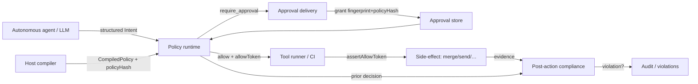
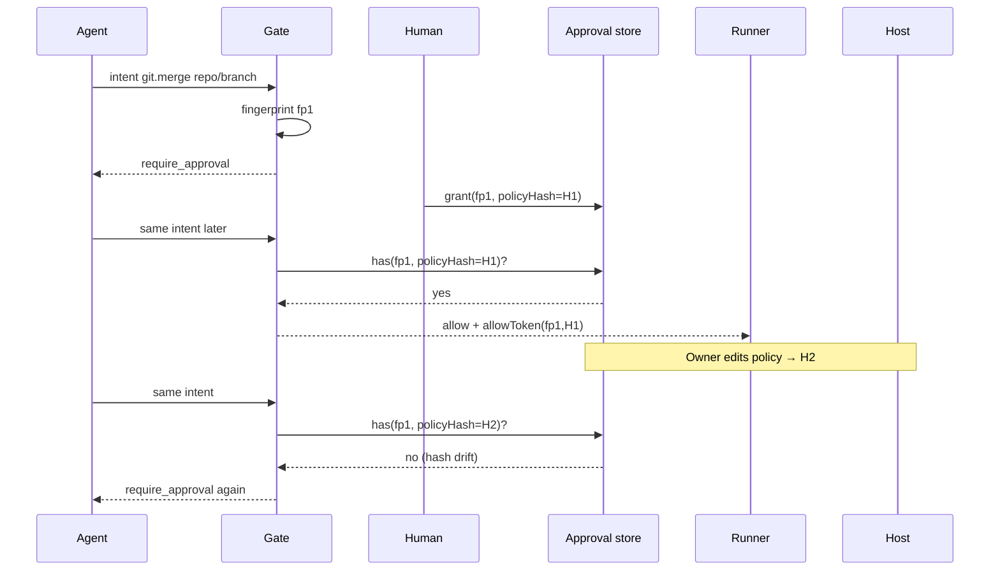
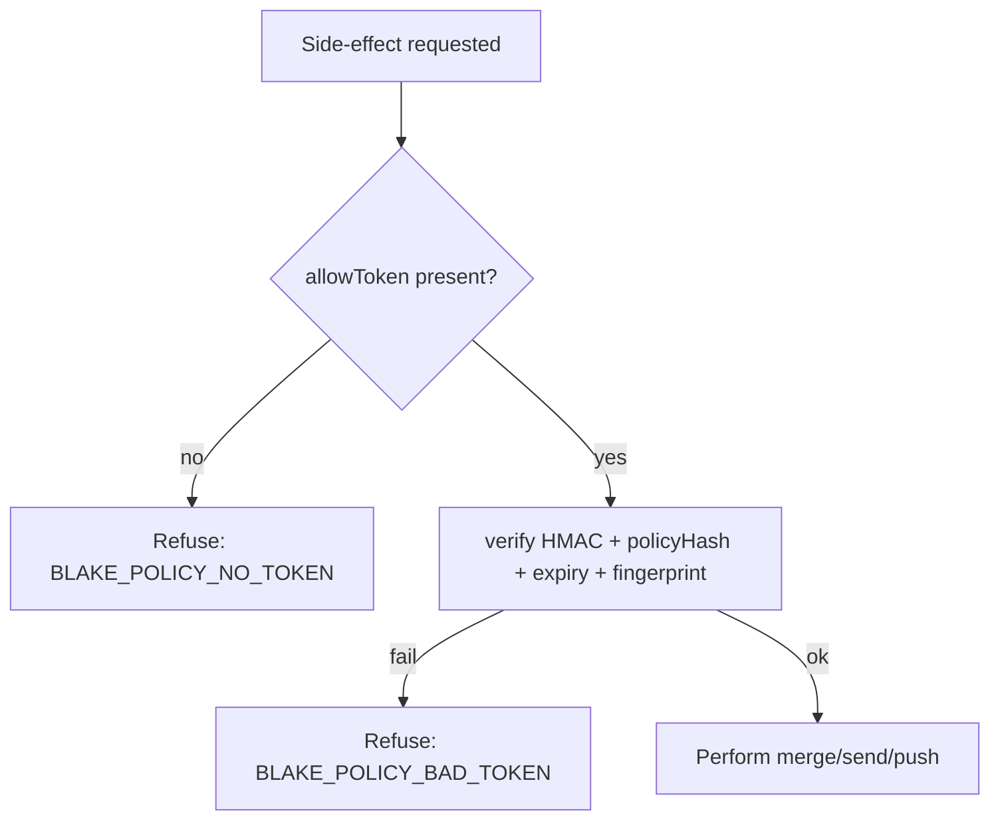
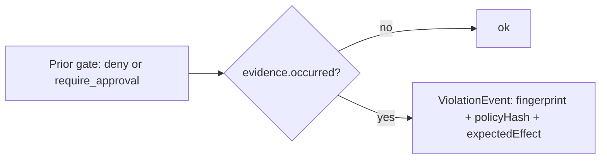

# Figure descriptions for provisional drawings

Export these to PDF/PNG for Patent Center. Mermaid can be rendered via any Mermaid live editor.

## Figure 1 — System context

## Figure 2 — Durable approval + policy drift

## Figure 3 — Fail-closed verify

## Figure 4 — Hire isolation matrix

| Environment \\ Scope | personal | org | hire |
|---------------------|----------|-----|------|
| personal_private | allow | — | deny |
| org_private | deny | allow | — |
| hire_sandbox | deny | deny | allow |

(Exact cells per `HIRE_ISOLATION_CASES` in source.)

## Figure 5 — Post-action compliance

